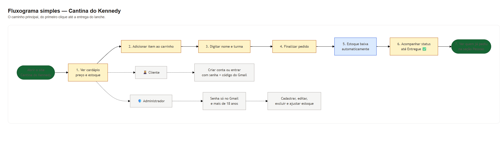

# Cantina do Kennedy

Site para fazer pedidos de lanches da cantina.

🌐 **Site no ar:** https://afonsomiguel700.github.io/cantina-kennedy/

## O que o site faz

- Cardápio com preços e **estoque** de cada produto.
- Carrinho com quantidades e total do pedido.
- Nome e turma do cliente e acompanhamento do status (Recebido → Preparando → Pronto → Entregue).
- Lista de **pessoas que já pediram** (sem senha).
- **Contas separadas**: cliente e administrador.
- Área do administrador com **CRUD de produtos**: cadastrar, editar, excluir e ajustar estoque.
- Ao finalizar um pedido, o estoque dos produtos baixa automaticamente.

## Como funcionam as contas

Na seção **Minha conta** você escolhe entre **Entrar** e **Criar conta**.

### 🧑‍🎓 Cliente
- Informa nome, turma, e-mail e senha (somente números, mínimo 4 dígitos).
- Serve somente para fazer pedidos e acompanhar o status.
- Não consegue mexer nos produtos.

### 🛡️ Administrador
- Precisa informar nome, e-mail, **data de nascimento** e declarar ter **mais de 18 anos**.
- O site gera uma senha de **6 dígitos** (somente números) e abre o **Gmail** com uma mensagem pronta para a pessoa enviar para si mesma. A senha **não aparece no site**: ela vem somente dentro do e-mail.
- Depois é só abrir o e-mail no Gmail, copiar a senha e entrar escolhendo **“Sou administrador”**.

### 🔢 Etapa extra ao entrar

Tanto cliente quanto administrador, ao escolher **Entrar**, precisam:

1. Informar o tipo de conta, o e-mail e a senha cadastrada.
2. Receber um **código de 6 dígitos** no Gmail (o site abre a mensagem pronta).
3. Copiar o código do e-mail, digitá-lo no site e clicar em **“Confirmar e entrar”**.

O código **não aparece no site**: fica só dentro do e-mail e na memória da aba. Se o e-mail não abriu, use **“Reabrir e-mail com o código”**. Se errar ou desistir, clique em **“Cancelar”** para começar de novo.

> ⚠️ Como o site é estático (GitHub Pages), ele **não envia e-mails sozinho**: o Gmail abre com a mensagem pronta e a pessoa clica em enviar. A idade é conferida pela data de nascimento informada — também não há verificação com documento. Tudo fica salvo somente neste navegador. Isso é uma separação simples para o projeto, não uma segurança de verdade.

## Fluxograma simples (versão fácil)

- [ Abrir fluxograma simples interativo](https://afonsomiguel700.github.io/cantina-kennedy/fluxograma-simples.html)

## Fluxograma completo

- [ Abrir fluxograma completo interativo](https://afonsomiguel700.github.io/cantina-kennedy/fluxograma.html)
- [ Ver código do fluxograma completo (Mermaid)](fluxograma.md)

## Arquivos

| Arquivo | O que faz |
| --- | --- |
| `index.html` | Estrutura das telas do site |
| `style.css` | Cores, layout e tema claro/escuro |
| `app.js` | Regras: contas, produtos, estoque, carrinho, pedidos e pessoas |
| `fluxograma-simples.png` | Versão resumida do fluxo (7 passos) |
| `fluxograma.png` | Desenho do fluxo completo do site |
| `fluxograma-simples.html` | Versão interativa do fluxograma simples |
| `fluxograma.html` | Versão interativa do fluxograma completo |
| `fluxograma.md` | Código-fonte do fluxograma completo em Mermaid |
