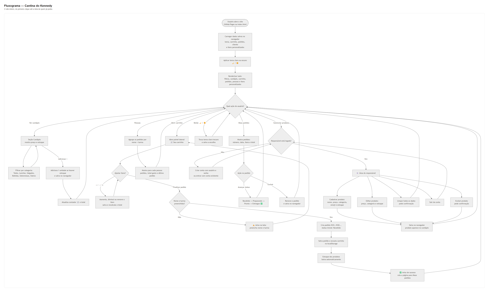

# Cantina do Kennedy

Site para fazer pedidos de lanches da cantina.

🌐 **Site no ar:** https://afonsomiguel700.github.io/cantina-kennedy/

## O que o site faz

- Cardápio com preços e **estoque** de cada produto.
- Carrinho com quantidades e total do pedido.
- Nome e turma do cliente e acompanhamento do status (Recebido → Preparando → Pronto → Entregue).
- Lista de **pessoas que já pediram** (sem senha).
- Área do responsável com **login/cadastro** e **CRUD de produtos**: cadastrar, editar, excluir e ajustar estoque.
- Ao finalizar um pedido, o estoque dos produtos baixa automaticamente.

> O login e os dados são locais: funcionam somente no navegador onde foram criados.

## Fluxograma simples (versão fácil)

- [ Abrir fluxograma simples interativo](https://afonsomiguel700.github.io/cantina-kennedy/fluxograma-simples.html)

## Fluxograma completo

- [ Abrir fluxograma completo interativo](https://afonsomiguel700.github.io/cantina-kennedy/fluxograma.html)
- [ Ver código do fluxograma completo (Mermaid)](fluxograma.md)

## Arquivos

| Arquivo | O que faz |
| --- | --- |
| `index.html` | Estrutura das telas do site |
| `style.css` | Cores, layout e tema claro/escuro |
| `app.js` | Regras: login, produtos, estoque, carrinho, pedidos e pessoas |
| `fluxograma-simples.png` | Versão resumida do fluxo (7 passos) |
| `fluxograma.png` | Desenho do fluxo completo do site |
| `fluxograma-simples.html` | Versão interativa do fluxograma simples |
| `fluxograma.html` | Versão interativa do fluxograma completo |
| `fluxograma.md` | Código-fonte do fluxograma completo em Mermaid |
