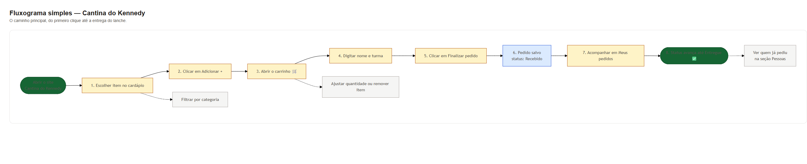

# Fluxograma simples — Cantina do Kennedy

Versão resumida: o caminho principal do site em 8 passos.

- [Abrir versão interativa](https://afonsomiguel700.github.io/cantina-kennedy/fluxograma-simples.html)
- [Ver fluxograma completo](fluxograma.md)

## Código Mermaid

```mermaid
flowchart LR
    A(["Abrir o site<br/>Cantina do Kennedy"])
    B["1. Escolher item no cardápio"]
    C["2. Clicar em Adicionar +"]
    D["3. Abrir o carrinho 🛒"]
    E["4. Digitar nome e turma"]
    F["5. Clicar em Finalizar pedido"]
    G["6. Pedido salvo<br/>status: Recebido"]
    H["7. Acompanhar em Meus pedidos"]
    I(["8. Status avança até Entregue ✅"])

    A --> B --> C --> D --> E --> F --> G --> H --> I

    B -.-> J["Filtrar por categoria"]
    D -.-> K["Ajustar quantidade ou remover item"]
    I -.-> L["Ver quem já pediu<br/>na seção Pessoas"]

    classDef inicio fill:#166534,stroke:#14532d,color:#ffffff;
    classDef acao fill:#fef3c7,stroke:#b45309,color:#78350f;
    classDef salvo fill:#dbeafe,stroke:#1d4ed8,color:#1e3a8a;
    classDef extra fill:#f5f5f4,stroke:#a8a29e,color:#44403c;
    class A,I inicio;
    class B,C,D,E,F,H acao;
    class G salvo;
    class J,K,L extra;
```

