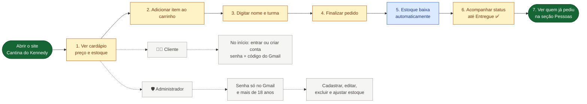

# Fluxograma simples — Cantina do Kennedy

Versão resumida: o caminho principal do site em 7 passos, incluindo contas de cliente e administrador, estoque e gerenciamento de produtos.

- [Abrir versão interativa](https://afonsomiguel700.github.io/cantina-kennedy/fluxograma-simples.html)
- [Ver fluxograma completo](fluxograma.md)

## Código Mermaid

