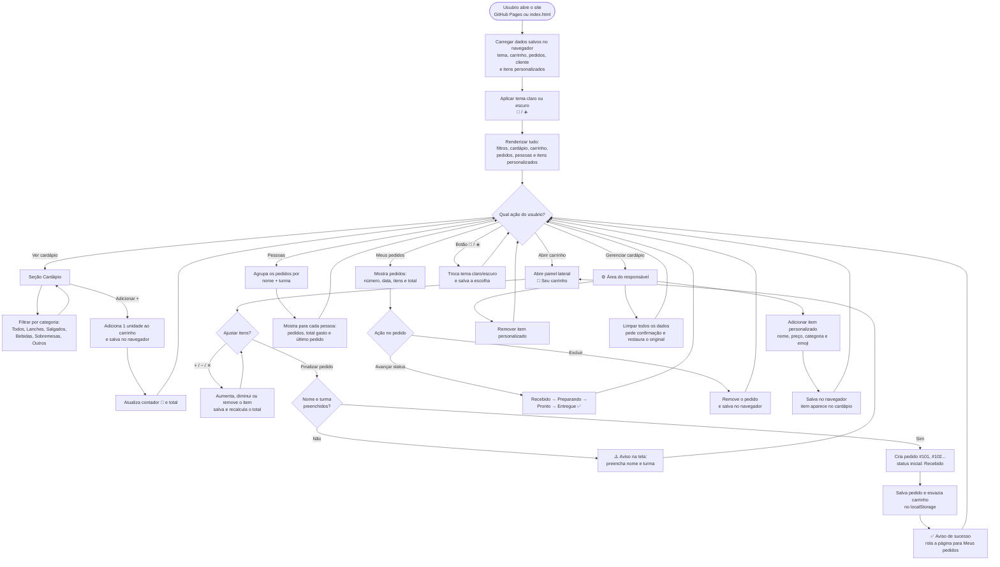
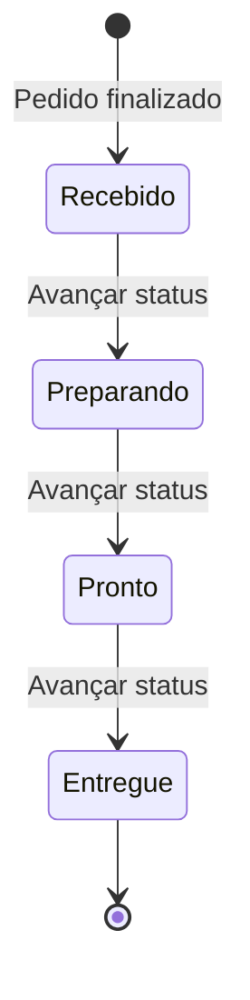
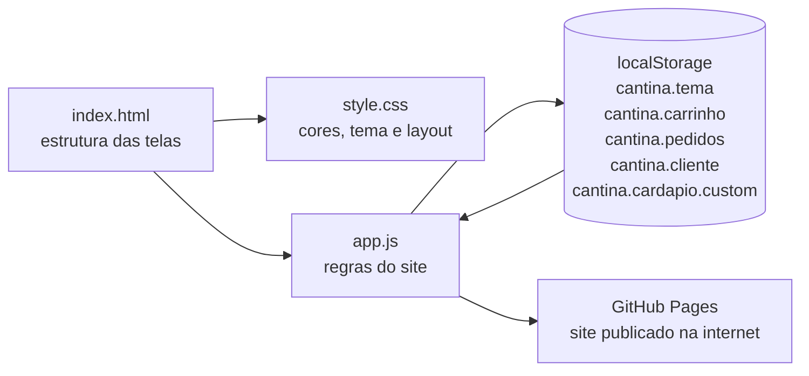

# Fluxograma — Cantina do Kennedy

Este arquivo mostra o caminho completo do site: o que acontece quando a pessoa abre a página, como ela faz um pedido, como acompanha o status e o que o responsável pela cantina pode fazer.

> Os textos abaixo estão em **Mermaid**, uma linguagem para desenhar fluxogramas. Você pode colar este código em sites como https://mermaid.live para ver o desenho, ou abrir o arquivo `fluxograma.html` que já vem pronto para visualizar.

---

## 1. Fluxograma principal (o site inteiro)

---

## 2. Estado dos pedidos

---

## 3. De onde vêm os dados

**Observação importante:** os dados ficam salvos **apenas no navegador** de quem usou o site. Por isso a lista de pessoas mostra só os pedidos feitos naquele mesmo navegador.
